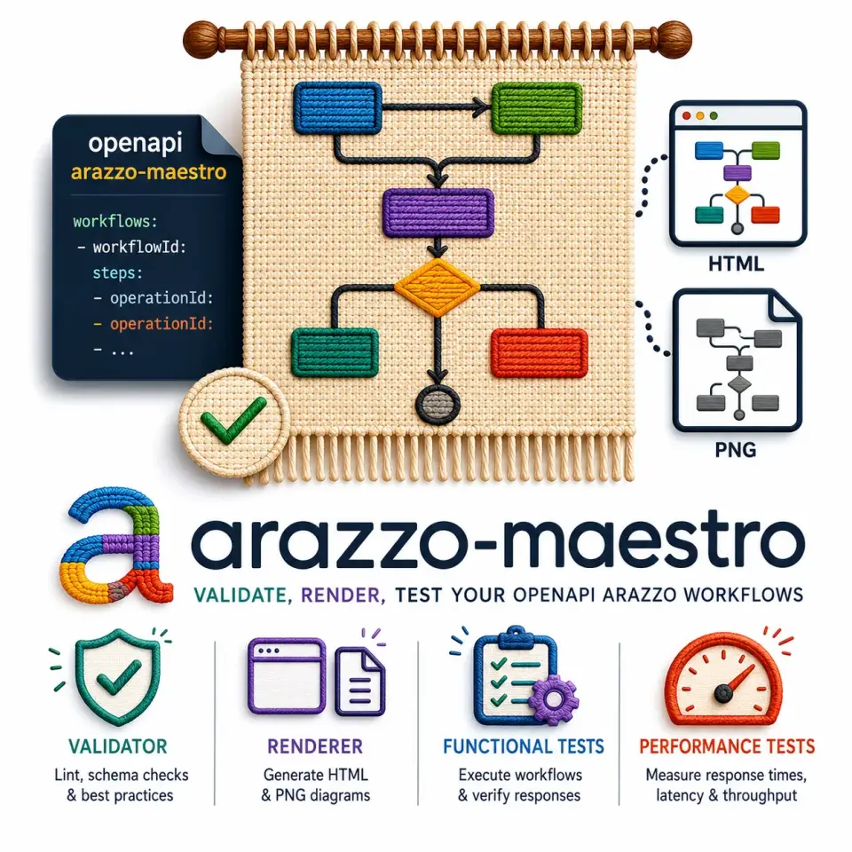
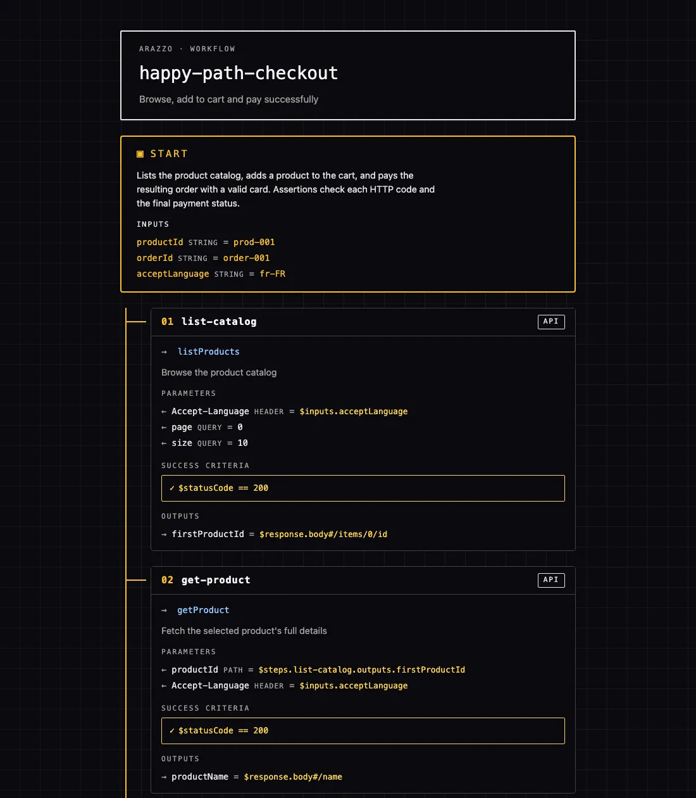
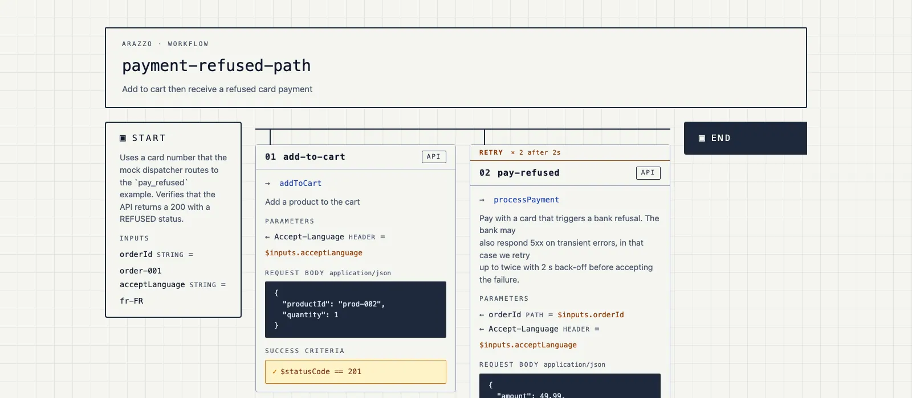
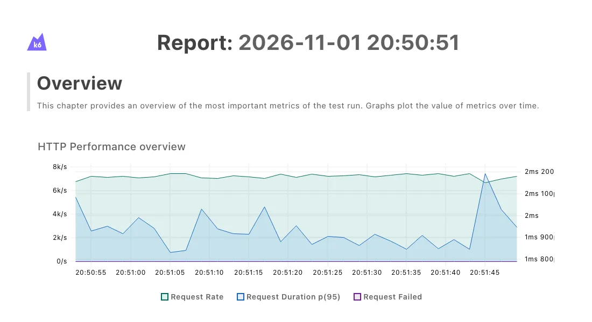

OpenAPI décrit chaque appel de votre API de manière isolée. Cependant, l'enchaînement de ces appels, le vrai parcours métier, n'a souvent aucun contrat.  
Arazzo comble ce vide, et [**arazzo-maestro**](https://emmanuelperu.github.io/arazzo-maestro/) le rend utile au reste de l'équipe : un linter pour la CI, un rendu lisible par tout le monde, et des tests générés.

<!-- truncate -->



> Petite confession avant de commencer : ça me fatigue d'entendre « le swagger de l'API » 🤪. Swagger, c'est le nom qu'avait la spec jusqu'en version 2.0 ! Depuis 2016, elle s'appelle OpenAPI, et Swagger désigne une famille d'outils.  
> Mais au-delà du mot, c'est l'intention qui me gêne : « le swagger », c'est une page de doc générée qu'on consulte. Moi, je parle d'un **contrat** : un document qu'on écrit d'abord, qu'on valide, qu'on versionne, et sur lequel on s'engage.
> Et justement, cet article parle d'étendre ce contrat là où il n'existe pas encore.

## Le parcours que tout le monde connaît et que personne n'a écrit

Prenez un parcours d'achat tout simple : on liste le catalogue, on récupère le détail d'un produit, on l'ajoute au panier, on paie.
Quatre appels. Si le paiement échoue sur une erreur 5xx de la banque, on retente deux fois, puis on abandonne.

Où vit ce parcours aujourd'hui ? Un peu dans la tête d'un dev, un peu dans un wiki qui date de la dernière "réorg", un peu dans une collection Postman,  
et un peu dans trois tests e2e qui se battent en duel et qui ne racontent pas tout à fait la même histoire.

Chaque endpoint, lui, a son contrat OpenAPI, validé, linté, versionné. On a des contrats pour les mots, mais pas pour les phrases.

Alors comment expliquer à vos consommateurs l'enchaînement des appels ? Que faut-il appeler en premier quand c'est nécessaire ? Quelle sortie permet quel appel ? Toutes ces questions laissées sans réponse si longtemps ont enfin une solution normée !

## Arazzo en 90 secondes

[Arazzo](https://spec.openapis.org/arazzo/latest.html) est la spécification de workflows de l'OpenAPI Initiative.
Le nom veut dire "tapisserie" en italien : l'idée est de tisser des appels d'API entre eux. Retenez quatre notions, pas plus :

- `sourceDescriptions` : les contrats OpenAPI sur lesquels le workflow s'appuie
  - On peut parler d'OpenAPI, mais on peut aussi parler d'AsyncAPI ! Et dans la vraie vie, on interagit souvent avec un système de manière synchrone et asynchrone, Arazzo permet donc de décrire la vraie vie de vos APIs, peu importe si elles sont synchrones ou non.
- `workflows` : les parcours eux-mêmes
- `steps` : chaque étape pointe un `operationId` du contrat, avec ses paramètres et ses `successCriteria`
- `outputs` et les *runtime expressions* : c'est le fil qui relie les étapes (`$steps.list-catalog.outputs.firstProductId`)

Extrait de l'exemple `shop.arazzo.yaml` livré avec l'outil (à retrouver dans le repo) :

```yaml
sourceDescriptions:
  - name: shop-api
    url: ./shop-openapi.yaml
    type: openapi

workflows:
  - workflowId: happy-path-checkout
    steps:
      - stepId: list-catalog
        operationId: listProducts
        successCriteria:
          - condition: $statusCode == 200
        outputs:
          firstProductId: $response.body#/items/0/id

      - stepId: get-product
        operationId: getProduct
        parameters:
          - name: productId
            in: path
            value: $steps.list-catalog.outputs.firstProductId
```

:::info[« Des workflows ? Mais on a déjà BPMN ! »]
Arazzo n'est pas du BPMN, et ne cherche pas à le remplacer. Ils ne travaillent pas à la même altitude.
BPMN modélise le **processus métier** : des acteurs, des tâches humaines, des délais, des décisions, le tout souvent orchestré par un moteur de processus.
Arazzo décrit la **séquence d'appels d'API** : quelle opération appeler, avec quelles données, quelle valeur de la réponse réutiliser, et ce qui compte comme un succès.
Les deux se complètent : la tâche « Payer la commande » d'un diagramme BPMN peut très bien être détaillée, côté API, par un workflow Arazzo. Le premier dit *quoi* et *qui*, le second dit *comment, appel par appel*.
:::

C'est lisible, c'est déclaratif, et c'est du YAML. Le jour où quelqu'un renomme une opération dans le contrat, qui pense à mettre ce fichier à jour ?

## Pourquoi un outil de plus

Il existe déjà des plugins Arazzo pour VS Code par exemple et un validateur Node chez Jentic. Ils aident à **écrire** un workflow : autocomplétion, aperçu, validation à la frappe.
Ce qui manquait, c'est **l'après** : bloquer une PR quand le workflow ne tient plus, montrer le parcours à quelqu'un qui n'ouvre jamais d'IDE, et transformer tout ça en tests.

Et puis maintenant, il y a l'éléphant dans la pièce : l'IA.

Assistants de code et agents lisent désormais nos contrats pour générer des clients, écrire des tests ou appeler directement nos APIs.  
Avec un contrat OpenAPI seul, ils voient des endpoints isolés : dans quel ordre les appeler, quelle valeur de la réponse réinjecter dans l'appel suivant, quoi faire quand le paiement échoue ? Ils devinent. Souvent juste, parfois faux, et toujours avec le même aplomb.

Un workflow Arazzo leur donne l'enchaînement noir sur blanc, dans un format qu'ils lisent aussi bien que nous. À condition qu'il soit juste : un fichier Arazzo écrit (ou généré) de travers, c'est une erreur transmise avec autorité.  
D'où l'intérêt d'un garde-fou déterministe, qui ne devine rien : laissez le modèle proposer, laissez le contrat trancher.

**arazzo-maestro** est né d'un besoin beaucoup plus modeste : *voir* un workflow.
Un premier POC Python, `arazzo-visualiser`, puis une réécriture en Go, quand le besoin a dépassé le dessin. Je voulais un dessin, j'ai fini avec un linter, deux générateurs de tests et un badge OpenSSF en cours. Ça arrive.

Le principe : un fichier en entrée, trois verbes en sortie.

```text
*.arazzo.yaml + contrats OpenAPI ──► arazzo-maestro ──┬─► lint  → exit 0/1 + erreurs lisibles
                                                      ├─► view  → HTML autonome ou Mermaid
                                                      └─► test  → Hurl (e2e) ou k6 (perf)
```

Le mois dernier, j'ai donné [un talk sur les biais qu'expérimentent les techs](https://www.youtube.com/watch?v=2XOeQsp8nuc), et je suis peut-être, et même probablement, en plein effet IKEA, mais c'est mon produit :-) donc il est forcément bien !

## `lint` : une triple vérification

Le linter fait donc trois passes :

1. le **JSON Schema officiel** d'Arazzo (types, champs requis, formats)
2. des **règles sémantiques** : identifiants uniques, références `$steps` résolues, pas de référence vers une étape qui n'a pas encore eu lieu
3. une passe **cross-file** : il ouvre les contrats OpenAPI référencés et vérifie que chaque `operationId` existe vraiment

C'est la troisième qui provoque le moment "aha". Renommons `addToCart` en `addToBasket` dans le workflow (sans toucher au contrat), et faisons référencer à `get-product` sa propre sortie :

```text
$ arazzo-maestro lint broken.arazzo.yaml
[error] workflows[happy-path-checkout].steps[get-product].parameters.productId: reference $steps.get-product.outputs.productName: step "get-product" is not declared before this one
[error] workflows[happy-path-checkout].steps[add-to-cart].operationId: operation "addToBasket" not found in source "shop-api"
[error] workflows[payment-refused-path].steps[add-to-cart].operationId: operation "addToBasket" not found in source "shop-api"
Error: 3 issue(s) found
```

Code retour 1, donc branchable tel quel en CI ou en hook pre-commit :

```yaml
# .github/workflows/arazzo.yml (extrait)
- uses: actions/setup-go@v5
  with: { go-version: '1.26' }
- run: |
    go install github.com/emmanuelperu/arazzo-maestro/cmd/arazzo-maestro@latest
    arazzo-maestro lint workflows/checkout.yaml
```

Le contrat OpenAPI et le workflow ne peuvent plus diverger en silence. C'est tout l'intérêt du contract-first : la dérive devient une PR rouge, pas un incident.

Confession numéro deux : pour coller au plus près de la spec, je me suis fait aider par l'IA. Six relectures en parallèle, une par grande section du texte officiel, et chaque écart revérifié en exécutant le code (l'IA propose, les tests tranchent).
Tout est consigné dans [`SPEC_COMPLIANCE.md`](https://github.com/emmanuelperu/arazzo-maestro/blob/main/docs/SPEC_COMPLIANCE.md) : un fichier qui dit ce qu'on vérifie avec certitude, et surtout ce qu'on ne vérifie pas (ou pas encore plutôt).

## `view` : le schéma pour ceux qui n'ouvrent pas d'IDE

`view` produit une page HTML autonome par workflow : pas de serveur, pas de build, pas de framework JavaScript. On l'ouvre dans un navigateur, on la commite dans un dossier de doc, on la publie sur GitHub Pages.
Trois thèmes sont fournis (`light`, `dark` et `pb33f`), et on peut définir le sien dans un `themes.yml`.

:::tip[Pourquoi un thème « pb33f » ?]
C'est un clin d'œil néon à [pb33f.io](https://pb33f.io), alias Princess Beef Heavy Industries, l'atelier de Dave Shanley. Si vous faites de l'OpenAPI sérieusement, vous utilisez peut-être déjà son travail sans le savoir.
**arazzo-maestro** lui doit beaucoup : [libopenapi](https://github.com/pb33f/libopenapi) lit les contrats pour la passe cross-file, et [vacuum](https://quobix.com/vacuum/) a servi à valider les contrats d'exemple (100/100, on ne s'en lasse pas).
Moi, perso, j'adore son design system : d'où ce thème, né le premier jour du projet. Disons que c'était une dette de reconnaissance contractée d'avance.
:::



Le détail qui compte : on voit le `productId` de l'étape 2 venir de la sortie de l'étape 1. Le fil de la tapisserie, littéralement.

Pour les écrans larges et les slides, `--layout landscape` déroule le parcours à l'horizontale. Ici le chemin "paiement refusé", avec sa politique de retry affichée sur l'étape :



Et si vous préférez du texte, `--format mermaid` génère un `.mmd` qui s'affiche directement dans GitHub ou dans votre IDE :

```text
flowchart TD
  wfStart([Start])
  s0["01 add-to-cart<br/>addToCart"]
  s1["02 pay-refused<br/>processPayment"]
  wfEnd([End])
  wfStart --> s0
  s0 --> s1
  s1 --> wfEnd
  s1 -. "retry x2 after 2s" .-> s1
  s1 -. "on failure" .-> wfEnd
```

## `test` : du contrat au test qui tourne

`test gen e2e` transforme chaque workflow en fichier [Hurl](https://hurl.dev), `test run e2e` l'exécute contre l'environnement de votre choix (avec un rapport HTML en option), et `test gen perf` produit un script [k6](https://k6.io).

Petite dédicace au passage : c'est mon collègue Abdoul Boubacar qui m'a parlé de Hurl en premier. Des tests HTTP en texte brut, versionnables et lisibles sans IDE : lui s'en servait pour valider ses modifications de WAF, c'était exactement la cible qu'il me fallait.

```bash
arazzo-maestro test gen e2e examples/shop.arazzo.yaml -o dist/
# wrote dist/e2e/hurl/shop/happy-path-checkout.hurl
```

Chaque requête est préfixée par `{{baseUrl}}`, les sorties deviennent des captures, et les captures alimentent les étapes suivantes :

```text
# Step: list-catalog
GET {{baseUrl}}/products
Accept-Language: {{acceptLanguage}}
[QueryStringParams]
page: 0
size: 10

HTTP *
[Asserts]
# $statusCode == 200
[Captures]
list-catalog_firstProductId: jsonpath "$.items[0].id"

# Step: get-product
GET {{baseUrl}}/products/{{list-catalog_firstProductId}}
```

Vous avez remarqué le `# $statusCode == 200` en commentaire ? Ce n'est pas un oubli : aujourd'hui, les `successCriteria` sont recopiés en commentaires dans le bloc `[Asserts]`, pas encore traduits en vraies assertions Hurl.
C'est le parti pris de l'outil : ce qu'il ne sait pas traduire fidèlement devient un commentaire explicite, jamais une supposition. Un test qui passe "au hasard" est pire qu'un test absent.

Côté performance, `test gen perf` produit un script [k6](https://k6.io) qui suit exactement le même parcours, avec la charge et les seuils passés en ligne de commande :

```bash
arazzo-maestro test gen perf examples/shop.arazzo.yaml --vus 10 --duration 60s \
  --threshold 'http_req_duration=p(95)<200' --threshold 'http_req_failed=rate<0.01'
```

Ici, les codes HTTP attendus deviennent de vrais `check()` k6. Les critères portant sur le corps de la réponse restent, eux, en commentaire :

```javascript
const add_to_cartRes = http.request('POST', `${BASE_URL}/cart/items`, JSON.stringify(add_to_cartBody), { headers: { "Content-Type": "application/json", "Accept-Language": acceptLanguage } });
// successCriteria (not translated): $response.body#/totalPrice > 0
check(add_to_cartRes, {
  "add-to-cart: $statusCode == 201": (r) => r.status === 201,
});
const add_to_cart_cartTotal = add_to_cartRes.json("totalPrice");
```

Pour écrire cet article, j'ai lancé ce script contre le mock [Microcks](https://microcks.io) livré dans le repo.

```bash
k6 run -e BASE_URL='http://localhost:8082/rest/Shop+API/1.0.0' \
  -e productId=p-001 -e orderId=ord-1 -e acceptLanguage=en \
  dist/perf/k6/shop/happy-path-checkout.k6.js
```

```text
✓ list-catalog: $statusCode == 200
✓ get-product: $statusCode == 200
✓ add-to-cart: $statusCode == 201
✓ pay: $statusCode == 200

checks.........................: 100.00% 432772 out of 432772
✓ http_req_duration..............: avg=1.35ms min=614µs med=1.26ms max=38.74ms p(90)=1.7ms p(95)=1.92ms
✓ http_req_failed................: 0.00%   0 out of 432772
```

Et avec `K6_WEB_DASHBOARD=true`, k6 exporte un rapport HTML de la session :



:::warning[Ne retenez pas ces chiffres]  
Environ 7 000 requêtes par seconde avec un p95 sous les 2 ms : c'est un mock Microcks qui tourne sur mon poste, pas une API. Ces chiffres mesurent ma machine, pas une réelle implémentation.  

Ce qu'il faut retenir, c'est le reste : un test de charge qui suit le parcours métier décrit dans le contrat, généré en une commande, avec des seuils qui font échouer la CI. Pointez `BASE_URL` sur votre recette, et là, les chiffres voudront dire quelque chose.
:::

## Les coulisses : ce que la spec m'a appris à la dure

### Hurl ne connaît pas les pointeurs JSON

Arazzo permet d'aller chercher une valeur *dans* une sortie : `$steps.list-catalog.outputs.items#/0/id`. Hurl, lui, ne sait pas faire ce sous-accès sur une variable à l'exécution.
La parade : repérer ces expressions à l'avance et ajouter une capture dérivée à l'étape qui produit la donnée.

```text
[Captures]
list-catalog_items: jsonpath "$.items"
list-catalog_items_0_id: jsonpath "$.items[0].id"
```

L'étape suivante consomme simplement `{{list-catalog_items_0_id}}`. Personne n'a à le savoir, et c'est très bien comme ça.

### Les vrais exemples cassent les jolis outils

En testant l'exemple "Warp API" publié par Redocly, le générateur Hurl a produit... une `map` Go sérialisée au lieu d'un corps JSON. La cause : un `requestBody` sans `contentType`.
La spec dit de retomber sur le content-type de l'opération ciblée, et l'outil ne le faisait pas. Corrigé depuis, mais la leçon reste : on n'éprouve pas un outil avec ses propres exemples.

### 😶, ma catégorie préférée

Dans `SPEC_COMPLIANCE.md`, un verdict mérite qu'on s'y arrête : 😶 *« accepté sans erreur, puis ignoré en silence »*. C'est le bug le plus sournois qui soit : le lint passe, rien ne crie, et la sortie ment par omission.
Lui donner un nom et un emoji, c'est l'empêcher de se cacher. Dire ce qu'on ne fait pas, c'est rare dans un README. C'est pourtant ce qui permet de faire confiance au reste.

### Un schéma 1.1 arrivé en cours de route

Quand l'outil est né, Arazzo 1.1 était publié mais pas son JSON Schema. **arazzo-maestro** chargeait donc le schéma 1.0 officiel et y greffait les ajouts structurels de la 1.1 au chargement.
Le [schéma officiel 1.1](https://spec.openapis.org/arazzo/1.1/schema/2026-04-15) est sorti depuis (avril 2026) et son intégration est en cours : il contient encore quelques écarts avec le texte de la spec, suivis dans les issues de l'OpenAPI Initiative, qu'il faut contourner sans rejeter des documents valides.
La sémantique propre à la 1.1, elle, reste à implémenter, et c'est écrit noir sur blanc.

## Les contraintes qu'on s'est imposées

Ce ne sont pas des slogans, ce sont des règles du repo, vérifiées par les tests et les revues.

- **Sobriété** : un binaire Go unique, une image Docker `FROM scratch` d'environ 20 Mo, une page HTML d'environ 29 ko (4,5 ko gzippée), sans JavaScript, et seulement 4 dépendances directes.
- **Accessibilité** : contrastes WCAG 2.2 AA vérifiés en test sur les thèmes fournis, et un thème personnalisé qui passe sous le seuil déclenche un avertissement au chargement.
- **Hors ligne par défaut** : aucun appel réseau sans `--allow-remote`. Avec l'option, les contrats peuvent venir d'une URL HTTPS, dans des limites strictes (taille, délai, redirections). Le HTTP simple reste refusé même avec l'option : un contrat modifié en transit changerait en silence les tests générés.
- **Chaîne de confiance** : releases signées avec cosign, SBOM fournis, score OpenSSF Scorecard publié. Pour un outil qu'on installe dans sa CI, ce n'est pas du luxe.

Écoconçu, accessible, signé : le seul truc qui pèse lourd, c'est le nom.

Enfin, presque. Vous avez tiqué sur les 20 Mo ? Moi aussi.

:::note[Pourquoi 20 Mo pour un outil qui se dit sobre ?]
Une image `FROM scratch` ne contient rien d'autre que le binaire : ses 20 Mo, c'est le binaire Go lui-même, runtime compris.
Avant l'arrivée de [libopenapi](https://github.com/pb33f/libopenapi), la bibliothèque qui lit les contrats OpenAPI pour la passe cross-file, il pesait environ 5 Mo.
Le surpoids vient de son package `index` : pour savoir suivre des `$ref` distants, il embarque toute la pile `net/http` et TLS de Go. Ironie du sort, **arazzo-maestro** a longtemps refusé tout chargement distant.
Pendant des mois, on a payé 15 Mo pour une porte condamnée. Avec `--allow-remote`, elle s'ouvre enfin, sur demande et en HTTPS seulement : ces 15 Mo ont trouvé leur utilité.
:::

:::note[Et l'export PNG de la bannière ?]
La bannière promet du PNG : l'export SVG/PNG est encore sur la [roadmap](https://github.com/emmanuelperu/arazzo-maestro/blob/main/docs/ROADMAP.md). Aujourd'hui, c'est HTML ou Mermaid.
:::

## Ce que ça ne fait pas (encore)

- Ce n'est **pas un moteur d'exécution** de workflows ni un orchestrateur : `test run` délègue à Hurl.
- Ce n'est **pas un éditeur** : gardez votre plugin VS Code, les deux sont complémentaires.
- Les **workflows imbriqués** (`step.workflowId`) sont affichés, mais les générateurs de tests les sautent avec un commentaire explicite.
- Les **critères de succès** ne sont pas encore des assertions Hurl, et la sémantique propre à Arazzo 1.1 reste à faire.

## Essayez-le en trois commandes

```bash
go install github.com/emmanuelperu/arazzo-maestro/cmd/arazzo-maestro@latest
arazzo-maestro lint examples/shop.arazzo.yaml
arazzo-maestro view examples/shop.arazzo.yaml --theme dark
```

Le projet est open source sous licence Apache 2.0 : [emmanuelperu/arazzo-maestro sur GitHub](https://github.com/emmanuelperu/arazzo-maestro).

## Pendant ce temps, dans l'atelier d'à côté

Je ne suis pas le seul à tisser, et ça s'accélère. Pour s'y retrouver, la communauté tient un annuaire : [usearazzo.com](https://usearazzo.com/ecosystem/) recense la spec, les outils, les articles et les exemples. **arazzo-maestro** y figure dans la rubrique « Lint &amp; validate », entre le validateur de Jentic et une action GitHub.

Alors oui, je prêche pour ma paroisse : aidez-moi à faire vivre **arazzo-maestro**. Une étoile sur le repo, c'est gentil. Un vrai fichier Arazzo qui fait tomber l'outil, c'est mieux. Une issue, une PR, un « chez nous, ça marche trop bien », c'est ce qui transforme un projet du dimanche en outil qu'on installe dans sa CI sans trembler.

Le contrat OpenAPI a rendu nos endpoints fiables. Il est temps que nos parcours le deviennent aussi.

